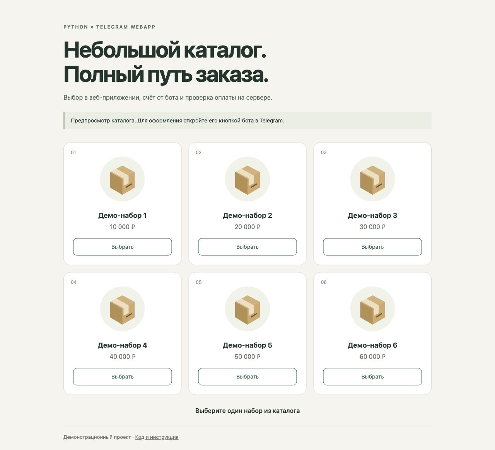

# Telegram WebApp — каталог и заказы

[](https://github.com/Sultanbro/Sultanbro.github.io/actions/workflows/tests.yml)

**Python / aiogram, SQLite, JavaScript.** Бот открывает каталог, принимает выбор товара, создаёт счёт и обрабатывает события оплаты. Заказ сохраняется на сервере и проверяется перед подтверждением.

[Открыть каталог](https://sultanbro.github.io/) · [Тесты](tests)



## Сценарий

```text
/start → кнопка каталога → WebApp.sendData(item_id)
       → проверка товара → заказ в SQLite → send_invoice(order_id)
       → pre_checkout_query: пользователь + сумма + валюта + срок
       → successful_payment: проверка и однократная регистрация
```

- Каталог содержит шесть демонстрационных позиций. Цены задаёт сервер в минимальных единицах валюты; клиент передаёт только идентификатор товара.
- Счёт связан с пользователем и уникальным заказом. Перед оплатой проверяются сумма, RUB, владелец, статус и срок в 30 минут.
- Заказы сохраняются в SQLite и переживают перезапуск процесса. Повторное событие с тем же идентификатором платежа не создаёт повторную обработку; один платёж нельзя привязать к двум заказам.
- Ошибка отправки счёта отменяет заказ. Отсутствующие или неизвестные товары не приводят к созданию счёта.
- Интерфейс адаптирован для телефона и обычного браузера. Вне Telegram работает предпросмотр без отправки заказа. Имя пользователя не используется как HTML или доказательство авторизации.

## Структура

| Файл | Назначение |
| --- | --- |
| [main.py](main.py) | Создание бота и запуск long polling |
| [handlers.py](handlers.py) | Обработчики Telegram с передаваемыми зависимостями |
| [shop.py](shop.py) | Каталог, хранение и проверка заказов |
| [config.py](config.py) | Параметры окружения и проверка HTTPS URL |
| [keyboards.py](keyboards.py) | Кнопка запуска WebApp |
| [index.html](index.html), [app.js](app.js), [style.css](style.css) | Адаптивный каталог и выбор товара |
| [requirements.txt](requirements.txt) | Закреплённые версии Python-зависимостей |
| [tests](tests) | Проверки заказов, обработчиков и JavaScript |

## Запуск бота

Окружение CI — **Python 3.11**; код использует API **aiogram 2.25.1**. Переход на aiogram 3 требует адаптации.

```sh
git clone https://github.com/Sultanbro/Sultanbro.github.io.git
cd Sultanbro.github.io
python3 -m venv .venv
. .venv/bin/activate
python -m pip install -r requirements.txt
```

Передайте процессу настройки из `.env.example` через IDE или менеджер процессов:

| Переменная | Значение |
| --- | --- |
| `BOT_TOKEN` | Токен вашего бота |
| `PAYMENTS_TOKEN` | Тестовый токен платёжного провайдера |
| `WEBAPP_URL` | HTTPS-адрес каталога, по умолчанию `https://sultanbro.github.io/` |
| `ORDERS_DB` | Путь SQLite, по умолчанию `data/orders.sqlite3` |

`.env` автоматически не загружается. Значения токенов не должны попадать в браузер или репозиторий. После настройки выполните `python main.py`. Для отправки заказа откройте каталог кнопкой бота в личном чате.

Для собственного хостинга разместите `index.html`, `app.js`, `style.css` и `product.svg`. Бот работает отдельным Python-процессом; GitHub Pages обслуживает только каталог.

## Проверки без токенов

```sh
python -m unittest discover -s tests -v
node --test tests/webapp.test.cjs
```

**16 Python-тестов** проверяют заказы и обработчики через подставной Telegram API. **4 JavaScript-теста** проверяют выбор/смену товара, отправку выбранного идентификатора, отсутствие SDK/пользователя и безопасное отображение имени. Интерфейс также проверен в браузере при ширине 390 px. GitHub Actions устанавливает зависимости и выполняет обе группы.

Полноценный обмен с Telegram и тестовым платёжным провайдером требует собственных настроек. Реальные счета и платежи при автоматической проверке не отправляются. Доставка товаров, возвраты, сверка с провайдером, восстановление уведомлений после сбоя и административная панель в проект не входят.

Протокол интеграции: [Telegram Web Apps](https://core.telegram.org/bots/webapps#keyboard-button-mini-apps), [проверка перед оплатой](https://core.telegram.org/bots/api#answerprecheckoutquery), [aiogram 2](https://docs.aiogram.dev/en/v2.25.1/examples/payments.html).
